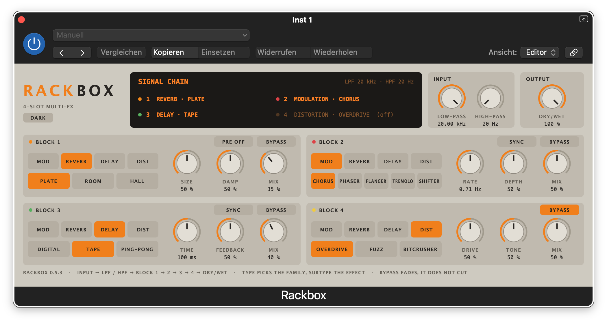
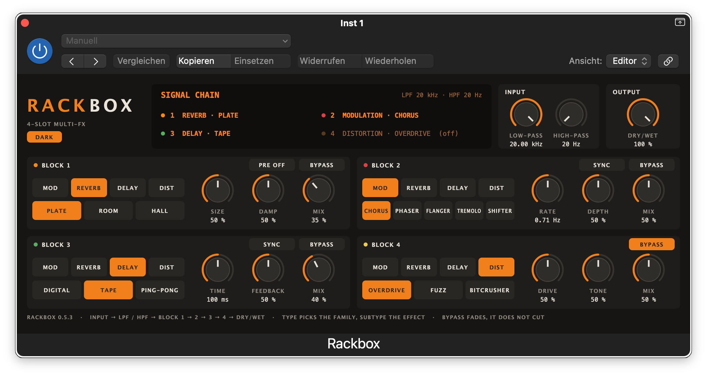

# Rackbox

A four-slot multi-effect for macOS - AU (aufx/Rbox/Tzor), VST3 and a standalone
app, built with JUCE 9, in Kitbox's look.

Family: [Kitbox](https://github.com/TZorr/Kitbox) (16-pad drum sampler), [Rackbox Plus](https://github.com/TZorr/RackboxPlus) (the same rack, eight knobs per effect), [FMBox](https://github.com/TZorr/FMBox) (eight-sound FM drum synth), [Chordbox](https://github.com/TZorr/Chordbox) (16-pad chord generator), [Transmute](https://github.com/TZorr/Transmute) (drum resynthesis).

**Dark** under the wordmark switches the panel to dark; the choice is yours,
not the session's - every Rackbox window and project opens the way you left it.

## Install

Download `Rackbox.0.7.0.pkg` from
[Releases](https://github.com/TZorr/Rackbox/releases) and run it; choose AU, VST3 or both - they go into `/Library/Audio/Plug-Ins`. Apple Silicon, macOS
26.5 or later. The installer is unsigned, so Gatekeeper refuses it at first:
right-click it and choose Open, or allow it under System Settings › Privacy &
Security.

## The rack

    Input -> LPF/HPF -> Block 1 -> 2 -> 3 -> 4 -> Dry/Wet -> Output

Each of the four blocks loads any of 14 effects, picked by **Type** (Modulation, Reverb, Delay,
Distortion) and **Subtype** (Modulation: Chorus, Phaser, Flanger, Tremolo, Shifter; Reverb:
Plate, Room, Hall; Delay: Digital, Tape, Ping-Pong; Distortion: Overdrive, Fuzz,
Bitcrusher). Every block has Bypass, two effect knobs (A, B - named after the
loaded effect) and its own Mix. Switching type, subtype or bypass crossfades over
30 ms. All parameters are in one `AudioProcessorValueTreeState` and automatable.

Identity: `aufx` / `Rbox` / `Tzor`, bundle id `TZorr.Rackbox`.

    Scripts/build.sh      build Release, run RackboxCheck and EditorShot, render build/shots/rackbox.png (+ rackbox-added.png, rackbox-dark.png)
    Scripts/install.sh    copy AU + VST3 (+ app) to ~/Library and /Applications, flush caches, run auval
    Scripts/package.sh    build + checks, then the AU/VST3 installer in build/

JUCE is expected at `~/JUCE` (or `-DJUCE_PATH=...`), with CMake and Ninja.

Layout: `Source/Engine` (Effect base class, catalog, EffectBlock, input filters,
`Effects/` one class per effect), `Source/UI` (Kitbox's Palette and Knob, block
panel, display), `Verification/` (engine measurements, processor checks + render).

Overdrive and Fuzz are anti-aliased without oversampling (first-order antiderivative
anti-aliasing, `Dsp::Adaa`, no latency): at full drive the harmonics that fold back below
10 kHz sit about 20 dB lower than a plain shaper's, and the top end the averaging softens is
lifted back. The Bitcrusher aliases on purpose.

Dynamics (Compressor, Limiter) was a fifth Type from 0.2.0 to 0.4.x and was taken out again in
0.5.0 to keep the rack lean. A session saved with a block on it loads with that block bypassed;
host automation recorded on a block's Type in those versions spans five values instead of four.

The Shifter (Modulation, added in 0.4.0) is a single-sideband frequency shifter: Shift moves
every frequency by the same number of Hz (-1000 to +1000, 0 at the centre, finely resolved
near it), Feedback sends the result round an 8 ms loop again - a comb whose teeth move on every
pass, the barber-pole that climbs or falls for ever at small shifts. The 90-degree split is a
pair of allpass chains designed for Rackbox (`Scripts/HilbertDesign.cpp`): no latency, the
mirror sideband at least 66 dB down from 10 Hz to Nyquist - 10 Hz at 48 kHz. Being allpass,
it turns phases even at 0 Hz, so blended with the dry signal on Mix it colours like a phaser
standing still. Modulation's fifth entry raised the Subtype range from four values to five:
saved sessions keep their subtype, but host automation recorded on a Subtype before 0.4.0
now spans five values.

Delay and Modulation blocks have a SYNC button: the Time (or Rate) knob then steps
through 14 note values (1/32 to 1/1, with triplets and dotted values) at the host
tempo, or 120 BPM when the host gives none. Synced modulation is phase-locked to the
host's beat grid while the transport runs (one cycle per note value), and free-runs at
the tempo's rate when stopped. Delays are held at 4 s (a whole note at
60 BPM); slower tempi are clamped there.

Reverb blocks have a PRE button where the others have SYNC: it steps (click; right-click
back) through a pre-delay of OFF, 1/128, 1/64, 1/32, 1/16, 1/8, 1/4, 1/2 and 1 bar, computed
from the host tempo and time signature (120 BPM, 4/4 without a host); the tooltip shows the
milliseconds. Changing it is a 30 ms crossfade, not a glide. Capped at 4 s.

Channels: stereo in/out, mono in / stereo out (a mono aux through reverb or chorus widens
the source) and mono in / mono out (the stereo chain is folded to mono). The AU reports
[1,1] [1,2] [2,2].

## Presets

**PRESETS** beside the Dark switch opens the plugin's own preset menu. It lists `~/Library/Audio/Presets/T'Zorr/Rackbox/`, and each subfolder becomes a submenu. It also has Save Preset…, Load Preset… and Show in Finder. Presets are `.rackbox` files: plain XML that names the plugin and holds its settings, readable in any text editor. Logic keeps its own `.aupreset` settings in its own menu; the two do not mix. In VST3 hosts such as Bitwig this menu is the only way to load and save presets.

## Licence

Rackbox is © 2026 T'Zorr and is distributed under AGPLv3 - see
[LICENSE](LICENSE). This follows from linking JUCE's free tier, which is
AGPLv3 itself; details in [THIRD_PARTY_NOTICES.md](THIRD_PARTY_NOTICES.md).

## Contact

T'Zorr - <TZorr@gmx.de>
